# VALORE_SCREEN_MAP — MAPEAMENTO COMPLETO DE TELAS E INTERFACES

> **Documento de Auditoria Visual, Funcional e Arquitetural de Frontend**  
> **Projeto:** Valore (Plataforma Demonstrativa de Crédito Pessoal e Correspondente Bancário)  
> **Finalidade:** Transferência de Contexto Completa de UX/UI, Telas, Estados e Fluxos para o ChatGPT e Engenheiros de Frontend.  
> **Data da Auditoria:** 23 de Outubro de 2026  
> **Diretório das Capturas de Tela:** [`docs/mapeamento-visual/screenshots/`](./screenshots/)  
> **Total de Telas Mapeadas:** 37 telas individuais + 2 modais complexos de retenção/interação.  
> **Total de Capturas Geradas:** 76 screenshots reais (Mobile 390×844 e Desktop 1440×900).

---

## A. RESUMO VISUAL DO PROJETO

A interface da **Valore** foi concebida sob uma estética fintech moderna, combinando elementos de confiança bancária institucional com psicologia de conversão acelerada (CRO - *Conversion Rate Optimization*). O design é **Mobile-First**, pensado para uma experiência ágil em smartphones (telas de 375px a 430px de largura), mas possui layout responsivo e centralizado em containers elegantes no Desktop (max-width de 480px no funil e containers amplos na Landing Page).

### 1. Paleta de Cores e Identidade Visual

* **Verde Neon Elétrico (Primary / CTA):** `hsl(76, 83%, 58%)` / `#B4F045` — Utilizado para destacar botões de ação máxima (`.btn-alive`), tags de crédito pré-aprovado, elementos de aprovação e destaques na Landing Page.
* **Verde Ação / Confirmação:** `#16A34A` / `#22C55E` — Utilizado em botões de ação principal do funil e checkout, selos de garantia e ícones de sucesso.
* **Verde Floresta Escuro / Institucional:** `#2E5535` / `#1B3220` — Utilizado em cards institucionais de segurança, banners de "Boa notícia", cabeçalhos de suporte e garantias de reembolso.
* **Preto Profundo / Carbono:** `#0F1712` / `#0B1410` — Cor de fundo heroica na Home e cor de tipografia principal em textos e títulos (`text-foreground`).
* **Superfícies Claras (Background do Funil):** `#EEF1EC` / `#F8FAF7` — Fundo neutro e fosco que transmite seriedade, conforto visual e contraste perfeito com os cards brancos (`#FFFFFF`).
* **Vermelho Alerta / Inconsistência:** `#EF4444` / `#B91C1C` / `#FEF2F2` — Utilizado no modal de saída (*exit-intent*) e nas telas de detalhamento de recusa bancária e falha técnica simulada.
* **Azul Segurança:** `#38BDF8` / `#1D4ED8` — Utilizado em selos verificados e integração de avisos Web Push.

### 2. Tipografia e Escala Visual

* **Família Tipográfica Principal:** `Inter`, `system-ui`, `-apple-system`, `sans-serif` (importada via Google Fonts).
* **Família Monospaçada:** `ui-monospace`, `SFMono-Regular`, `Menlo`, `Monaco`, `monospace` (utilizada especificamente para exibição de códigos PIX copia e cola e chaves de segurança).
* **Hierarquia:**
  * Títulos de Impacto (Hero): `text-5xl` a `text-7xl` (48px a 72px) com tracking fechado (`tracking-tight`) e leading de `1.1`.
  * Títulos de Etapa / H1 do Funil: `text-2xl` a `text-3xl` (24px a 30px), peso `font-bold` (700) ou `font-extrabold` (800).
  * Subtítulos e Contexto: `text-sm` a `text-base` (14px a 16px) com classe `text-muted-foreground` (`#64748B` / `#5A6B5D`).
  * Textos Legais e Micro-copy: `text-xs` (11px a 12px) para termos de consentimento, selos LGPD e explicações de estorno.

### 3. Componentes e Estilo de Interface

* **Bordas Arredondadas:** Padrão consistente de cantos suaves — `rounded-2xl` (16px) para cards padrão e `rounded-3xl` (24px) para cards de destaque ou blocos de checkout. Botões adotam `rounded-full` (pill shape) na Home e `rounded-xl` / `rounded-2xl` no fluxo de formulários.
* **Sombras e Elevação:** Uso de sombras difusas profundas (`shadow-xl`, `shadow-2xl`) combinadas com bordas sutis (`border border-border` ou `border border-[#0f1712]/10`).
* **Barra de Progresso Global:** Presente no topo de todas as etapas do funil de qualificação (componente `Kde`), com preenchimento verde dinâmico de 10% a 100%, sincronizado com o array de etapas `_xe`.

---

## B. CATÁLOGO DE TELAS DO SISTEMA

Abaixo estão listadas todas as telas e interfaces mapeadas no projeto, com seu ID único, nome, rota ou estado interno, status de implementação, arquivo responsável e referências de screenshot.

| ID | Nome da Tela | Rota / Estado | Status | Arquivo Responsável | Screenshot Desktop | Screenshot Mobile |
|:---|:---|:---|:---|:---|:---|:---|
| **TELA-001** | Landing Page Oficial | `/` | Implementada e Acessível | `public/assets/index-DNDXb9c6.js` (`Ude`) | [Desktop](./screenshots/TELA-001-home-desktop.png) | [Mobile](./screenshots/TELA-001-home-mobile.png) |
| **TELA-002** | Simulador de Valor e Parcelas | `/valor` | Implementada e Acessível | `public/assets/index-DNDXb9c6.js` (`cfe`) | [Desktop](./screenshots/TELA-002-simulador-valor-desktop.png) | [Mobile](./screenshots/TELA-002-simulador-valor-mobile.png) |
| **TELA-003** | Identificação por CPF | `/cpf` | Implementada e Acessível | `public/assets/index-DNDXb9c6.js` (`ufe`) | [Desktop](./screenshots/TELA-003-coleta-cpf-desktop.png) | [Mobile](./screenshots/TELA-003-coleta-cpf-mobile.png) |
| **TELA-004** | Confirmação de Dados Cadastrais | `/confirmacao` | Implementada e Acessível | `public/assets/index-DNDXb9c6.js` (`hfe`) | [Desktop](./screenshots/TELA-004-confirmacao-dados-desktop.png) | [Mobile](./screenshots/TELA-004-confirmacao-dados-mobile.png) |
| **TELA-005** | Contato e Criação de Senha | `/dados` | Implementada e Acessível | `public/assets/index-DNDXb9c6.js` (`xfe`) | [Desktop](./screenshots/TELA-005-contato-senha-desktop.png) | [Mobile](./screenshots/TELA-005-contato-senha-mobile.png) |
| **TELA-006** | Ocupação e Renda Mensal | `/renda` | Implementada e Acessível | `public/assets/index-DNDXb9c6.js` (`vfe`) | [Desktop](./screenshots/TELA-006-renda-ocupacao-desktop.png) | [Mobile](./screenshots/TELA-006-renda-ocupacao-mobile.png) |
| **TELA-007** | Análise de Crédito em Tempo Real | `/analise` | Implementada e Acessível | `public/assets/index-DNDXb9c6.js` (`wfe`) | [Desktop](./screenshots/TELA-007-analise-credito-desktop.png) | [Mobile](./screenshots/TELA-007-analise-credito-mobile.png) |
| **TELA-008** | Ativação Push na Qualificação | `/push` | Implementada e Condicional | `public/assets/index-DNDXb9c6.js` (`jfe`) | [Desktop](./screenshots/TELA-008-qualificacao-push-desktop.png) | [Mobile](./screenshots/TELA-008-qualificacao-push-mobile.png) |
| **TELA-009** | Crédito Aprovado | `/aprovacao` | Implementada e Acessível | `public/assets/index-DNDXb9c6.js` (`Afe`) | [Desktop](./screenshots/TELA-009-aprovacao-credito-desktop.png) | [Mobile](./screenshots/TELA-009-aprovacao-credito-mobile.png) |
| **TELA-010** | Escolha do Dia de Vencimento | `/dia` | Implementada e Acessível | `public/assets/index-DNDXb9c6.js` (`Cfe`) | [Desktop](./screenshots/TELA-010-vencimento-parcela-desktop.png) | [Mobile](./screenshots/TELA-010-vencimento-parcela-mobile.png) |
| **TELA-011** | Endereço Residencial (ViaCEP) | `/endereco` | Implementada e Acessível | `public/assets/index-DNDXb9c6.js` (`Efe`) | [Desktop](./screenshots/TELA-011-endereco-residencial-desktop.png) | [Mobile](./screenshots/TELA-011-endereco-residencial-mobile.png) |
| **TELA-012** | Dados Bancários e Chave PIX | `/conta` | Implementada e Acessível | `public/assets/index-DNDXb9c6.js` (`kfe`) | [Desktop](./screenshots/TELA-012-dados-bancarios-desktop.png) | [Mobile](./screenshots/TELA-012-dados-bancarios-mobile.png) |
| **TELA-013** | Abertura de Conta Digital | `/abrindo` | Implementada e Acessível | `public/assets/index-DNDXb9c6.js` (`Bfe`) | [Desktop](./screenshots/TELA-013-abertura-conta-desktop.png) | [Mobile](./screenshots/TELA-013-abertura-conta-mobile.png) |
| **TELA-014** | Conta Digital Pronta / Saldo | `/digital` | Implementada e Acessível | `public/assets/index-DNDXb9c6.js` (`Jfe`) | [Desktop](./screenshots/TELA-014-conta-digital-desktop.png) | [Mobile](./screenshots/TELA-014-conta-digital-mobile.png) |
| **TELA-015** | Contratação Seguro Prestamista | `/seguro` | Implementada e Acessível | `public/assets/index-DNDXb9c6.js` (`Zfe`) | [Desktop](./screenshots/TELA-015-seguro-prestamista-desktop.png) | [Mobile](./screenshots/TELA-015-seguro-prestamista-mobile.png) |
| **TELA-016** | Checkout PIX com QR Code | `/checkout` | Implementada e Acessível | `public/assets/index-DNDXb9c6.js` (`nxe`) | [Desktop](./screenshots/TELA-016-checkout-pix-desktop.png) | [Mobile](./screenshots/TELA-016-checkout-pix-mobile.png) |
| **TELA-017** | Pagamento Confirmado | `/pagamento` | Implementada e Acessível | `public/assets/index-DNDXb9c6.js` (`lxe`) | [Desktop](./screenshots/TELA-017-confirmacao-pagamento-desktop.png) | [Mobile](./screenshots/TELA-017-confirmacao-pagamento-mobile.png) |
| **TELA-018** | Cobrança de IOF Regulamentar | `/iof` | Implementada e Acessível | `public/assets/index-DNDXb9c6.js` (`uxe`) | [Desktop](./screenshots/TELA-018-cobranca-iof-desktop.png) | [Mobile](./screenshots/TELA-018-cobranca-iof-mobile.png) |
| **TELA-019** | Tarifa de Cadastro Bancário | `/tarifa` | Implementada e Acessível | `public/assets/index-DNDXb9c6.js` (`mxe`) | [Desktop](./screenshots/TELA-019-tarifa-cadastro-desktop.png) | [Mobile](./screenshots/TELA-019-tarifa-cadastro-mobile.png) |
| **TELA-020** | Download do Contrato / App | `/download` | Implementada e Acessível | `public/assets/index-DNDXb9c6.js` (`pxe`) | [Desktop](./screenshots/TELA-020-download-contrato-desktop.png) | [Mobile](./screenshots/TELA-020-download-contrato-mobile.png) |
| **TELA-021** | Taxa de Ativação do Aplicativo | `/taxa-app` | Implementada e Acessível | `public/assets/index-DNDXb9c6.js` (`yxe`) | [Desktop](./screenshots/TELA-021-taxa-aplicativo-desktop.png) | [Mobile](./screenshots/TELA-021-taxa-aplicativo-mobile.png) |
| **TELA-022** | Aumento de Limite Especial | `/limite` | Implementada e Acessível | `public/assets/index-DNDXb9c6.js` (`vxe`) | [Desktop](./screenshots/TELA-022-aumento-limite-desktop.png) | [Mobile](./screenshots/TELA-022-aumento-limite-mobile.png) |
| **TELA-023** | Assinatura de Contrato Digital | `/assinatura` | Implementada e Acessível | `public/assets/index-DNDXb9c6.js` (`wxe`) | [Desktop](./screenshots/TELA-023-assinatura-contrato-desktop.png) | [Mobile](./screenshots/TELA-023-assinatura-contrato-mobile.png) |
| **TELA-024** | Resumo Financeiro Final | `/resumo` | Implementada e Acessível | `public/assets/index-DNDXb9c6.js` (`jxe`) | [Desktop](./screenshots/TELA-024-resumo-financeiro-desktop.png) | [Mobile](./screenshots/TELA-024-resumo-financeiro-mobile.png) |
| **TELA-025** | Processamento de Transferência | `/processando` | Implementada e Acessível | `public/assets/index-DNDXb9c6.js` (`t4`) | [Desktop](./screenshots/TELA-025-processamento-ted-desktop.png) | [Mobile](./screenshots/TELA-025-processamento-ted-mobile.png) |
| **TELA-026** | Fila de Espera Bancária | `/fila` | Implementada e Acessível | `public/assets/index-DNDXb9c6.js` (`Cxe`) | [Desktop](./screenshots/TELA-026-fila-espera-prioridade-desktop.png) | [Mobile](./screenshots/TELA-026-fila-espera-prioridade-mobile.png) |
| **TELA-027** | Validação SFN / CIP | `/validacao` | Implementada e Acessível | `public/assets/index-DNDXb9c6.js` (`Txe`) | [Desktop](./screenshots/TELA-027-validacao-cip-desktop.png) | [Mobile](./screenshots/TELA-027-validacao-cip-mobile.png) |
| **TELA-028** | Transferência Validada | `/validado` | Implementada e Acessível | `public/assets/index-DNDXb9c6.js` (`Exe`) | [Desktop](./screenshots/TELA-028-transferencia-validada-desktop.png) | [Mobile](./screenshots/TELA-028-transferencia-validada-mobile.png) |
| **TELA-029** | Reprocessamento de Transferência | `/reprocessando` | Implementada e Acessível | `public/assets/index-DNDXb9c6.js` (`t4`) | [Desktop](./screenshots/TELA-029-reprocessamento-bancario-desktop.png) | [Mobile](./screenshots/TELA-029-reprocessamento-bancario-mobile.png) |
| **TELA-030** | Transferência Recusada pelo Banco | `/recusada` | Implementada e Acessível | `public/assets/index-DNDXb9c6.js` (`Pxe`) | [Desktop](./screenshots/TELA-030-transferencia-recusada-desktop.png) | [Mobile](./screenshots/TELA-030-transferencia-recusada-mobile.png) |
| **TELA-031** | Falha e Estorno de Taxa | `/estorno` | Implementada e Acessível | `public/assets/index-DNDXb9c6.js` (`kxe`) | [Desktop](./screenshots/TELA-031-estorno-taxa-protecao-desktop.png) | [Mobile](./screenshots/TELA-031-estorno-taxa-protecao-mobile.png) |
| **TELA-032** | Termos de Privacidade | `/privacidade` | Implementada e Acessível | `public/assets/index-DNDXb9c6.js` (`Ixe`) | [Desktop](./screenshots/TELA-032-politica-privacidade-desktop.png) | [Mobile](./screenshots/TELA-032-politica-privacidade-mobile.png) |
| **TELA-033** | Termos e Condições de Uso | `/termos` | Implementada e Acessível | `public/assets/index-DNDXb9c6.js` (`qxe`) | [Desktop](./screenshots/TELA-033-termos-de-uso-desktop.png) | [Mobile](./screenshots/TELA-033-termos-de-uso-mobile.png) |
| **TELA-034** | Retomada de Sessão / Lead | `/retomar` | Implementada e Acessível | `public/assets/index-DNDXb9c6.js` (`Hxe`) | [Desktop](./screenshots/TELA-034-retomada-sessao-desktop.png) | [Mobile](./screenshots/TELA-034-retomada-sessao-mobile.png) |
| **TELA-035** | Ativação Direta de Web Push | `/ativar-push` | Implementada e Acessível | `public/assets/index-DNDXb9c6.js` (`Kxe`) | [Desktop](./screenshots/TELA-035-ativar-push-desktop.png) | [Mobile](./screenshots/TELA-035-ativar-push-mobile.png) |
| **TELA-036** | Página 404 / Não Encontrada | `/404` (qualquer rota inválida) | Implementada e Acessível | `public/assets/index-DNDXb9c6.js` (`o8`) | [Desktop](./screenshots/TELA-036-erro-404-desktop.png) | [Mobile](./screenshots/TELA-036-erro-404-mobile.png) |
| **TELA-037** | Painel Administrativo (Lock) | `/p/:key` | Implementada (Bloqueio) | `public/assets/index-DNDXb9c6.js` (`O6e`) | [Desktop](./screenshots/TELA-037-admin-lockscreen-desktop.png) | [Mobile](./screenshots/TELA-037-admin-lockscreen-mobile.png) |
| **TELA-038** | Modal Exit-Intent (Checkout) | Pop-up condicional no `/checkout` | Implementada e Acessível | `public/index.html` (DOM dinâmico) | — | [Mobile](./screenshots/TELA-038-modal-exit-intent-mobile.png) |
| **TELA-039** | Chat Gerente Virtual Mariana | Widget flutuante no `/checkout` | Implementada e Acessível | `public/index.html` (Typebot dinâmico) | — | [Mobile](./screenshots/TELA-039-chat-gerente-virtual-mobile.png) |

---

## C. DETALHAMENTO INDIVIDUAL DAS TELAS

### TELA-001 — Landing Page Oficial (`/`)
* **Identificação:** Rota `/`. Componente `Ude`.
* **Elementos Visuais:**
  * **Header:** Logo tipográfico `valore.` em branco com acento verde, botão discreto de menu/acesso.
  * **Hero Section:** Fundo escuro texturizado com grid tecnológico sutil (`#0B1410`). Selo flutuante de pill `⚡ Crédito pessoal pré-aprovado`. Título gigante: `Até R$ 20.000 direto no seu PIX` com sublinhado ondulado orgânico no texto "direto no seu PIX".
  * **Call to Action (CTA):** Botão animado `Simular meu crédito` com pulsação suave e efeito glow.
  * **Selos de Confiança:** `✔ Aprova negativado`, `✔ Sem fiador`, `✔ Pix em 10 min`.
  * **Card Demonstrativo Interativo:** Card em ângulo mostrando mock de notificação bancária: `Transferência Recebida - R$ 15.000,00 - Remetente: Valore Pagamentos` acompanhado de selo `Aprovado! Em 2 minutos`.
  * **Social Proof Widget (Ao Vivo):** Caixa dinâmica na base informando `● AO VIVO 392 pessoas analisando agora` e carrossel de aprovações em tempo real (ex.: *"João S. recebeu R$ 10.226,46 via Pix"*).
  * **Seções Inferiores:** Simulador rápido na própria página, explicação de funcionamento em 3 etapas, comparativo de taxas de juros frente a concorrentes, depoimentos de clientes com fotos e notas 5 estrelas, FAQ e rodapé com dados da empresa e links de termos.
* **Comportamento:** Ao clicar em `Simular meu crédito`, aciona a transição limpa para a rota `/valor`.

### TELA-002 — Simulador de Empréstimo (`/valor`)
* **Identificação:** Rota `/valor`. Componente `cfe`.
* **Elementos Visuais:**
  * **Header do Funil:** Logo `valore.`, botão `Voltar` (que direciona para `/`) e barra de progresso verde marcando **10%**.
  * **Título Principal:** `De quanto você precisa?`
  * **Subtítulo:** `Escolha o valor e o prazo ideal para você.`
  * **Display de Valor:** Valor formatado em destaque central (ex.: `R$ 10.000,00`).
  * **Slider Interativo:** Controle deslizante com limites de R$ 500 a R$ 20.000 (passo de R$ 500).
  * **Seleção de Parcelas:** Grade de botões seletores abrangendo de **12x até 60x** (12x, 24x, 36x, 48x, 60x), calculadas com taxa aproximada de **0,81% ao mês**.
  * **Card de Resumo das Parcelas:** Exibição clara do valor da parcela mensal estimada (ex.: `24x de R$ 520,38`).
  * **Botão CTA:** `Continuar com este valor` (avança para `/cpf`).
* **Validações:** Valor mínimo de R$ 500 e máximo de R$ 20.000.

### TELA-003 — Coleta de CPF (`/cpf`)
* **Identificação:** Rota `/cpf`. Componente `ufe`.
* **Elementos Visuais:**
  * Barra de progresso em **18%**.
  * **Título:** `Qual é o seu CPF?`
  * **Subtítulo:** `Usamos seu CPF apenas para consultar suas condições de crédito.`
  * **Campo de Entrada:** Input com máscara automática de CPF (`000.000.000-00`), teclado numérico nativo em dispositivos móveis (`inputmode="numeric"`).
  * **Aviso de Segurança:** Ícone de cadeado acompanhado do texto `Consulta segura e sigilosa. Não afeta seu score de crédito.`
  * **Botão CTA:** `Consultar crédito gratuito`.
* **Comportamento e Integração:** Ao submeter, aciona `POST /api/cpf-lookup`. Se a API retornar dados válidos da pessoa (Nome, Data de Nascimento, Sexo, Mãe), os dados são salvos em `localStorage` e na sessão para auto-preenchimento das etapas seguintes.
* **Validações:** Validação de formato (11 dígitos numéricos) e algoritmo oficial de validação de dígitos verificadores de CPF (módulo 11).

### TELA-004 — Confirmação Cadastral (`/confirmacao`)
* **Identificação:** Rota `/confirmacao`. Componente `hfe`.
* **Elementos Visuais:**
  * Barra de progresso em **25%**.
  * **Título:** `Confirme seus dados cadastrais`
  * **Campos:** Nome Completo, Data de Nascimento, Sexo e Nome da Mãe.
  * **Botão CTA:** `Confirmar e avançar`.
* **Comportamento:** Se os dados vieram da consulta de CPF da API, eles aparecem preenchidos para verificação rápida do usuário, minimizando atrito cognitivo.

### TELA-005 — Contato e Senha (`/dados`)
* **Identificação:** Rota `/dados`. Componente `xfe`.
* **Elementos Visuais:**
  * Barra de progresso em **32%**.
  * **Título:** `Como podemos falar com você?`
  * **Campos:** Celular / WhatsApp com máscara DDD (`(11) 98765-4321`), E-mail pessoal e campo para criação de senha de acesso de 4 a 6 dígitos com confirmação.
  * **Selo LGPD:** Checkbox confirmando aceite da política de privacidade e autorização para envio de notificações sobre o status da proposta.
  * **Botão CTA:** `Continuar`.
* **Comportamento:** Aciona a sincronização com `POST /api/visitors` registrando o lead completo e capturando parâmetros de tráfego (UTMs).

### TELA-006 — Renda e Ocupação (`/renda`)
* **Identificação:** Rota `/renda`. Componente `vfe`.
* **Elementos Visuais:**
  * Barra de progresso em **40%**.
  * **Título:** `Informações profissionais`
  * **Campos:**
    * Finalidade do empréstimo (Reformar casa, Pagar dívidas, Capital de giro, Veículo, etc.).
    * Ocupação / Tipo de vínculo (Assalariado/CLT, Servidor Público, Autônomo, Aposentado/Pensionista, Desempregado).
    * Renda mensal aproximada com máscara monetária (R$).
  * **Botão CTA:** `Analisar meu crédito`.

### TELA-007 — Análise de Crédito em Tempo Real (`/analise`)
* **Identificação:** Rota `/analise`. Componente `wfe`.
* **Elementos Visuais:**
  * Barra de progresso em **50%**.
  * **Animação Central:** Radar pulsante circular com ícones de bancos e bureaus de crédito (Banco Central, Serasa, CIP).
  * **Etapas Animadas da Análise:**
    1. *Consultando birôs de crédito...*
    2. *Calculando margem consignável...*
    3. *Buscando as menores taxas de juros...*
    4. *Crédito pré-aprovado encontrado!*
  * **Tempo de Execução:** Aproximadamente 4 a 6 segundos para conferir realismo e valor percibido pelo usuário.
* **Comportamento:** Ao concluir a contagem progressiva (100%), transiciona automaticamente para `/push` ou `/aprovacao`.

### TELA-008 — Ativação de Push na Qualificação (`/push`)
* **Identificação:** Rota `/push`. Componente `jfe`.
* **Elementos Visuais:**
  * Barra de progresso em **60%**.
  * **Título:** `Receba o status da sua aprovação no celular`
  * **Ícone Central:** Sino de notificação dourado pulsando.
  * **Botões:** `Ativar notificações no meu aparelho` (dispara `Notification.requestPermission()`) e `Continuar sem notificações`.

### TELA-009 — Aprovação de Crédito (`/aprovacao`)
* **Identificação:** Rota `/aprovacao`. Componente `Afe`.
* **Elementos Visuais:**
  * Barra de progresso em **70%**.
  * **Banner Comemorativo:** Fundo verde com confetes sutis e ícone de aprovação.
  * **Destaque:** `Parabéns! Seu empréstimo foi aprovado!`
  * **Card de Oferta Formalizada:**
    * Valor Aprovado: `R$ 15.000,00`
    * Parcelas: `24x de R$ 520,38`
    * Taxa Mensal: `0,81% a.m.`
    * Liberação: `Imediata via PIX`
  * **Botão CTA:** `Contratar meu empréstimo`.

### TELA-010 — Vencimento das Parcelas (`/dia`)
* **Identificação:** Rota `/dia`. Componente `Cfe`.
* **Elementos Visuais:**
  * Barra de progresso em **80%**.
  * **Título:** `Qual o melhor dia para pagar suas parcelas?`
  * **Grade de Seleção de Dias:** Botões seletores para os dias **05, 10, 15, 20 e 25** de cada mês.
  * **Botão CTA:** `Avançar para dados de recebimento`.

### TELA-011 — Endereço Residencial (`/endereco`)
* **Identificação:** Rota `/endereco`. Componente `Efe`.
* **Elementos Visuais:**
  * Barra de progresso em **90%**.
  * **Título:** `Qual é o seu endereço residencial?`
  * **Campos:** CEP (com busca automática assíncrona consumindo `GET /api/cep/:cep`), Logradouro, Número, Complemento, Bairro, Cidade e UF.
  * **Botão CTA:** `Continuar`.

### TELA-012 — Dados Bancários e Chave PIX (`/conta`)
* **Identificação:** Rota `/conta`. Componente `kfe`.
* **Elementos Visuais:**
  * Barra de progresso em **96%**.
  * **Título:** `Onde você deseja receber o seu dinheiro?`
  * **Seleção do Tipo de Chave PIX:** Abas para CPF, Celular, E-mail ou Chave Aleatória.
  * **Campo de Chave PIX:** Input com validação correspondente ao tipo de chave selecionado.
  * **Instituição Bancária:** Seleção rápida de bancos brasileiros (Nubank, Caixa, Inter, Bradesco, Itaú, Santander, Banco do Brasil, etc.).
  * **Botão CTA:** `Cadastrar conta e receber PIX`.

### TELA-013 — Abertura de Conta Digital (`/abrindo`)
* **Identificação:** Rota `/abrindo`. Componente `Bfe`.
* **Elementos Visuais:**
  * Barra de progresso em **100%**.
  * **Animação Tecnológica:** Loader circular de geração de conta de custódia e emissão de contrato digital bancário.
* **Comportamento:** Redireciona com substituição de histórico (`replace: true`) para `/digital` em aproximadamente 2,5 segundos.

### TELA-014 — Conta Digital Pronta / Saldo Reservado (`/digital`)
* **Identificação:** Rota `/digital`. Componente `Jfe`.
* **Elementos Visuais:**
  * **Card de Saldo em Custódia:** Exibe o saldo liberado reservado para transferência imediata (ex.: `R$ 15.000,00`).
  * **Status:** `Aguardando ativação final para transferência imediata`.
  * **Botão CTA:** `Liberar transferência agora` (direciona para `/seguro`).

### TELA-015 — Seguro Prestamista (`/seguro`)
* **Identificação:** Rota `/seguro`. Componente `Zfe`.
* **Elementos Visuais:**
  * **Título:** `Proteção Financeira e Garantia de Cobertura`
  * **Subtítulo:** `O seguro prestamista garante a quitação do saldo devedor em caso de imprevistos e agiliza a liberação.`
  * **Cards de Opções de Planos:**
    1. **Seguro Básico:** Taxa única de depósito **R$ 16,80** (com badge *Mais Escolhido* e garantia de estorno).
    2. **Seguro Plus:** Cobertura estendida.
    3. **Seguro Premium:** Cobertura total com assistência funeral e premiação.
  * **Order Bumps (Opcionais Adicionais):**
    * *Cartão de Crédito Black com limite aprovado*
    * *Suporte Prioritário 24/7*
    * *Aumento Emergencial de Limite*
  * **Botão CTA:** `Seguir para ativação via PIX` (direciona para `/checkout`).

### TELA-016 — Checkout PIX Otimizado (`/checkout`)
* **Identificação:** Rota `/checkout`. Componente `nxe` + Injeção de CRO do `public/index.html`.
* **Elementos Visuais:**
  * **Título:** `Pague com PIX para liberar seu empréstimo`
  * **Cronômetro Regressivo de Urgência:** Contador regressivo de 15 minutos (`14:59`... `00:00`).
  * **Badge de Garantia 100% Reembolsável:** Box com ícone de escudo dourado informando que o valor da taxa é integralmente devolvido junto com o valor do empréstimo na conta do cliente.
  * **Exibição do QR Code PIX:** Imagem em alta definição de QR Code oficial e dinâmico.
  * **Box PIX Copia e Cola:** Código alfanumérico do PIX em caixa estilizada com botão verde de um clique: `COPIAR CÓDIGO PIX` (com feedback háptico e sonoro quando suportado pelo aparelho).
  * **Guia de Aplicativos Bancários:** Tags de atalho para os principais bancos do país (Nubank, Caixa Tem, Inter, Bradesco, Itaú, BB, Mercado Pago, Santander).
  * **Atalho para Atendente Mariana:** Card interativo `💬 Dúvidas para pagar o PIX? Fale com sua Gerente Mariana`.
  * **Card de Teste de Notificação:** Botão para testar o envio de push direto para o aparelho.
* **Comportamento Técnico:**
  * Ao carregar, efetua requisição `POST /api/orders` enviando `visitorId`, `productId` e `bumpIds`.
  * Inicia *polling* a cada 2 a 3 segundos consultando `GET /api/orders/:id`. Assim que a fatura mudar para `COMPLETED`, avança automaticamente para a próxima etapa configurada (`f()`, tipicamente `/pagamento` ou `/iof`).

### TELA-017 — Confirmação de Pagamento (`/pagamento`)
* **Identificação:** Rota `/pagamento`. Componente `lxe`.
* **Elementos Visuais:**
  * **Ícone de Sucesso:** Checkmark verde pulsante com confetes.
  * **Título:** `Pagamento confirmado com sucesso!`
  * **Subtítulo:** `Identificamos a compensação bancária da sua taxa.`
  * **Detalhes da Operação:** Comprovante com ID da transação, valor pago e status `LIQUIDADO`.
  * **Botão CTA:** `Avançar para liberação da transferência`.

### TELAS PÓS-CHECKOUT — Funil Complementar e Retenção Bancária (TELAS-018 a 031)
* **TELA-018 (`/iof`):** Cobrança regulamentar de IOF para emissão da cédula de crédito bancário (CCB). Componente `uxe`.
* **TELA-019 (`/tarifa`):** Cobrança de tarifa de registro cartorário / cadastro bancário. Componente `mxe`.
* **TELA-020 (`/download`):** Interface para download de minuta contratual em PDF e atalho para aplicativo mobile. Componente `pxe`.
* **TELA-021 (`/taxa-app`):** Ativação de token de segurança bancário no smartphone. Componente `yxe`.
* **TELA-022 (`/limite`):** Oferta personalizada de limite extra pré-aprovado liberado imediatamente. Componente `vxe`.
* **TELA-023 (`/assinatura`):** Painel interativo de assinatura digital da proposta de crédito. Componente `wxe`.
* **TELA-024 (`/resumo`):** Resumo executivo dos valores contratados e confirmação de chave PIX de recebimento. Componente `jxe`.
* **TELA-025 (`/processando`):** Animação de processamento bancário da TED/PIX pelo sistema emissor. Componente `t4`.
* **TELA-026 (`/fila`):** Indicação de fila de espera bancária e oferta de *Tarifa de Prioridade* para recebimento em 1 minuto. Componente `Cxe`.
* **TELA-027 (`/validacao`):** Tela de validação de titularidade junto à Câmara Interbancária de Pagamentos (CIP). Componente `Txe`.
* **TELA-028 (`/validado`):** Confirmação de validação cadastral com sucesso e disparo de lote de pagamentos. Componente `Exe`.
* **TELA-029 (`/reprocessando`):** Animação de reprocessamento após erro de comunicação com o banco emissor. Componente `t4`.
* **TELA-030 (`/recusada`):** Tela informativa de alta conversão: detalha que o banco do cliente recusou a transferência automática por valor atípico e apresenta a taxa de proteção necessária para liberação definitiva do montante retido. Componente `Pxe`.
* **TELA-031 (`/estorno`):** Notifica inconsistência temporária na compensação da taxa de proteção, comprova o estorno do valor para a conta do usuário e permite refazer o pagamento com garantia ativada. Componente `kxe`.

### TELAS INSTITUCIONAIS, RETOMADA E SUPORTE (TELAS-032 a 039)
* **TELA-032 (`/privacidade`):** Documento detalhado de Política de Privacidade, em conformidade com as diretrizes da Lei Geral de Proteção de Dados (LGPD - Lei 13.709/2018), detalhando direitos dos titulares e retenção de registros. Componente `Ixe`.
* **TELA-033 (`/termos`):** Termos e Condições de Uso da plataforma, detalhando a atuação como correspondente bancário regulamentado pela Resolução CMN 3.954 do Banco Central. Componente `qxe`.
* **TELA-034 (`/retomar`):** Ponto de aterrissagem inteligente para visitantes que clicaram em links de recuperação recebidos via Web Push ou SMS. Restaura o estado da simulação e redireciona para a última etapa pendente. Componente `Hxe`.
* **TELA-035 (`/ativar-push`):** Página dedicada para solicitação formal de permissão de notificações Web Push pelo navegador, com painel de disparo de teste imediato para validação pelo usuário. Componente `Kxe`.
* **TELA-036 (`/404`):** Página de erro para rotas não mapeadas na SPA, com botão de retorno seguro ao início. Componente `o8`.
* **TELA-037 (`/p/:key`):** Tela de proteção por senha do painel administrativo interno (*Lockscreen*). Componente `O6e`.
* **TELA-038 (Modal Exit-Intent):** Pop-up de retenção agressiva que detecta a intenção de saída do usuário na tela de checkout (movimento do cursor para o topo no desktop, clique em botão de voltar ou timer de 45 segundos). Exibe aviso em vermelho de perda de saldo e oferece botão de cópia direta do PIX.
* **TELA-039 (Chat Gerente Virtual Mariana):** Interface conversacional de atendente virtual inspirada no WhatsApp, com avatar profissional, selo de verificação, áudios simulados de digitação e 3 ramificações de dúvidas frequentes sobre pagamento com PIX Copia e Cola e garantia de estorno.

---

## D. FLUXOGRAMA DE NAVEGAÇÃO COMPLETO

O diagrama abaixo sintetiza a jornada de navegação completa do usuário pelo funil de captação, checkout e etapas complementares de pós-pagamento.

```mermaid
flowchart TD
    HOME["TELA-001: Home (/)"] -->|"CTA: Simular meu crédito"| VALOR["TELA-002: Simulador (/valor)"]
    VALOR -->|"Continuar com este valor"| CPF["TELA-003: Coleta CPF (/cpf)"]
    CPF -->|"POST /api/cpf-lookup"| CONFIRM["TELA-004: Confirmação (/confirmacao)"]
    CONFIRM -->|"Confirmar e avançar"| DADOS["TELA-005: Contato e Senha (/dados)"]
    DADOS -->|"POST /api/visitors"| RENDA["TELA-006: Renda e Ocupação (/renda)"]
    RENDA -->|"Analisar meu crédito"| ANALISE["TELA-007: Análise Crédito (/analise)"]
    
    ANALISE -->|"Push Disponível"| PUSH_QUALIF["TELA-008: Ativar Push (/push)"]
    ANALISE -->|"Push Não Disponível"| APROV["TELA-009: Crédito Aprovado (/aprovacao)"]
    PUSH_QUALIF --> APROV
    
    APROV -->|"Contratar empréstimo"| DIA["TELA-010: Vencimento (/dia)"]
    DIA -->|"Avançar"| ENDERECO["TELA-011: Endereço (/endereco)"]
    ENDERECO -->|"ViaCEP preenchido"| CONTA["TELA-012: Chave PIX (/conta)"]
    CONTA -->|"Cadastrar conta"| ABRINDO["TELA-013: Abertura Conta (/abrindo)"]
    ABRINDO -->|"Auto-replace 2.5s"| DIGITAL["TELA-014: Conta Digital (/digital)"]
    DIGITAL -->|"Liberar transferência"| SEGURO["TELA-015: Seguro Prestamista (/seguro)"]
    
    SEGURO -->|"Plano Básico R$ 16,80 + Bumps"| CHECKOUT["TELA-016: Checkout PIX (/checkout)"]
    
    CHECKOUT -.->|"Tentativa de abandono"| EXIT_MODAL["TELA-038: Modal Exit-Intent"]
    CHECKOUT -.->|"Dúvidas sobre PIX"| TYPEBOT["TELA-039: Chat Gerente Mariana"]
    EXIT_MODAL -->|"Copiar PIX e ficar"| CHECKOUT
    TYPEBOT -->|"PIX Copiado no chat"| CHECKOUT
    
    CHECKOUT -->|"Polling: Status COMPLETED"| PAGAMENTO["TELA-017: Pagamento Confirmado (/pagamento)"]
    
    PAGAMENTO --> IOF["TELA-018: IOF (/iof)"]
    IOF --> TARIFA["TELA-019: Tarifa Cadastro (/tarifa)"]
    TARIFA --> DOWNLOAD["TELA-020: Download Contrato (/download)"]
    DOWNLOAD --> TAXA_APP["TELA-021: Taxa App (/taxa-app)"]
    TAXA_APP --> LIMITE["TELA-022: Limite Extra (/limite)"]
    LIMITE --> ASSINATURA["TELA-023: Assinatura (/assinatura)"]
    ASSINATURA --> RESUMO["TELA-024: Resumo Final (/resumo)"]
    RESUMO --> PROCESSANDO["TELA-025: Processando TED (/processando)"]
    PROCESSANDO --> FILA["TELA-026: Fila de Espera (/fila)"]
    FILA --> VALIDACAO["TELA-027: Validação CIP (/validacao)"]
    VALIDACAO --> VALIDADO["TELA-028: Validado (/validado)"]
    VALIDADO --> REPROCESS["TELA-029: Reprocessando (/reprocessando)"]
    REPROCESS --> RECUSADA["TELA-030: Transferência Recusada (/recusada)"]
    RECUSADA --> ESTORNO["TELA-031: Estorno Taxa Proteção (/estorno)"]
    
    PUSH_MSG["Notificação Push Recebida"] --> RETOMAR["TELA-034: Retomada (/retomar)"]
    RETOMAR --> CHECKOUT
```

---

## E. MAPA DE COMPONENTES REUTILIZÁVEIS

| Nome do Componente | Identificador Minificado | Função Principal | Telas Onde é Utilizado |
|:---|:---|:---|:---|
| **SimProvider / useSim** | `r8` / `Lie` / `bv()` | Estado global reativo da simulação e formulário, sincronizado com `localStorage.getItem("valore:sim")`. | Presente em todas as 37 etapas do funil. |
| **Header do Funil** | Tag `<header>` em `Rxe` | Cabeçalho fixo com logotipo `valore.`, botão `Voltar` e barra de progresso. | TELA-002 até TELA-012. |
| **Barra de Progresso** | `Kde` | Indicador visual de percentual de conclusão baseado no mapeamento `_xe`. | TELA-002 até TELA-012. |
| **Card Container** | `a8`, `zie`, `i8`, `Uie` | Wrapper visual com borda, elevação e fundo branco para seções e formulários. | TELA-001 até TELA-037. |
| **Botão de Ação Primária** | `Fs` / `zy` | Botão com design responsivo, texto em maiúsculas, ícone e micro-animação ao toque. | TELA-001, 002, 009, 015, 016, 030, 031. |
| **Display Monetário** | `Ce` | Utilitário de formatação de moeda brasileira (`R$ 0,00`). | Presente em todas as telas com valores numéricos. |
| **Máscara de Input** | Funções auxiliares em `Rxe` | Formatação dinâmica em tempo real para CPF, Telefone/DDD e CEP. | TELA-003, 005 e 011. |
| **Loader / Animação de Processamento** | `t4` | Animação circular com texto de transição bancária e etapas sequenciais de status. | TELA-007, 013, 025 e 029. |
| **Exit-Intent Modal** | `#valore-exit-overlay` | Modal de alta conversão injetado no DOM que retém visitantes em tentativa de saída. | TELA-016 (Checkout). |
| **Typebot WhatsApp Widget** | `#valore-typebot-float` | Widget flutuante de chat com gerente de liberação e menu de dúvidas com cópia de PIX. | TELA-016 (Checkout). |

---

## F. INVENTÁRIO DE MODAIS, POP-UPS E ESTADOS CONDICIONAIS

1. **Modal de Abandono (Exit-Intent):**
   * *Gatilho:* Movimento do mouse saindo pelo topo da janela (`clientY <= 15px`) no Desktop; interceptação do botão Voltar do histórico do navegador no Mobile; ou inatividade de 45 segundos no checkout.
   * *Ação:* Bloqueia a navegação com overlay escuro (`rgba(15,23,42,0.85)`), destaca que o saldo aprovado voltará para a fila geral se a página for fechada e disponibiliza botão de ação imediata: `COPIAR PIX E LIBERAR MEU DINHEIRO`.
2. **Atendente Virtual Mariana (Typebot):**
   * *Gatilho:* Botão verde flutuante no canto inferior direito do checkout com badge de mensagem não lida e balão de preview após 5 segundos.
   * *Ação:* Abre janela de chat de 380px com histórico de mensagens simulando tempo de digitação e opções rápidas de dúvidas (*"Não sei como pagar PIX Copia e Cola"*, *"Tenho receio de pagar e não receber"*, *"Quanto tempo demora para cair"*).
3. **Card Inline de Ativação / Teste de Notificações:**
   * *Gatilho:* Aparece condicionalmente abaixo das tags bancárias no checkout caso o navegador do visitante suporte Web Push e a permissão ainda não tenha sido negada.
4. **Estados de Polling do Pedido PIX:**
   * *Pendente (`PENDING`):* Exibe contador de 15 minutos, QR Code e instruções de pagamento.
   * *Concluído (`COMPLETED`):* Detectado em até 2 segundos pelo polling do backend, dispara evento de conversão e transiciona de imediato para a tela de confirmação.

---

## G. ANÁLISE DE RESPONSIVIDADE: MOBILE VS DESKTOP

* **Mobile (390 × 844 px):**
  * O funil é extremamente otimizado para o polegar (*thumb-zone*). Botões têm altura generosa (56px a 60px), inputs utilizam tipografia de 16px para evitar zoom indesejado no iOS Safari, e seletores de banco e parcelas se organizam em grades de 2 colunas.
  * O botão de cópia de PIX aciona a vibração háptica nativa do dispositivo (`navigator.vibrate([80, 40, 80])`) e exibe feedback visual imediato de cópia efetuada.
* **Desktop (1440 × 900 px):**
  * Na Home (`/`), o layout se expande em 2 colunas amplas: coluna esquerda com títulos e chamada para ação; coluna direita com o mockup interativo do cartão e comprovante flutuante.
  * Dentro do funil (`/valor` até `/estorno`), o layout adota uma coluna centralizada com largura máxima controlada (`max-w-2xl` no cabeçalho e `max-w-md` nos formulários), garantindo foco visual absoluto e eliminando dispersão do usuário.

---

## H. DASHBOARD ADMINISTRATIVO (`/p/:key`)

O projeto possui mapeada no roteador do frontend uma área administrativa completa sob a rota dinâmica `/p/:key`, empacotada no componente `O6e` e na interface modular `yi`:

* **Módulos do Painel:**
  * **Visão Geral (`section="dashboard"`):** Cards de métricas de faturamento, volume de pedidos gerados, taxa de conversão PIX e gráficos de receita por período.
  * **Usuários e Leads (`section="users"` e `section="user-detail"`):** Listagem de visitantes, visualização de dados cadastrados (CPF, Telefone, E-mail) e etapa de abandono no funil.
  * **Produtos e Preços (`section="products"`):** Tabela de produtos ativos (`seguro-basico` a R$ 16,80, taxas adicionais e order bumps).
  * **Notificações Push (`section="push"`):** Gerenciador de campanhas, cadastro de modelos/templates, segmentação de audiência e histórico de execuções.
  * **Integrações e Gateways (`section="gateway"`, `section="integrations"`, `section="security"`):** Status operacional da QuantumPay, tokens Meta Pixel, chaves VAPID e autenticação de consultas de CPF.
* **Mecanismo de Proteção e Acesso Atual:**
  * Ao acessar `/p/:key`, o frontend verifica a existência de sessão ativa via `GET /api/admin/session`. Como este endpoint e o de autenticação (`POST /api/admin/login`) são gerenciados pelo servidor original de retaguarda e respondem 404 no servidor proxy atual, a tela de bloqueio com campo de senha permanece como barreira de segurança visual ativa.

---

## I. MAPA DE ARQUIVOS PARA MANUTENÇÃO VISUAL

| Elemento Visual | Arquivo Responsável | Linhas / Componentes Chave |
|:---|:---|:---|
| **Landing Page Principal** | `public/assets/index-DNDXb9c6.js` | Função `Ude` (Hero, badges, depoimentos, FAQ e footer). |
| **Etapas do Funil de 1 a 31** | `public/assets/index-DNDXb9c6.js` | Função `Rxe` e mapeamento de etapas `Si` / `_xe`. |
| **Simulador de Parcelas** | `public/assets/index-DNDXb9c6.js` | Função `cfe` (Sliders, grade de parcelas 12x a 60x e juros). |
| **Checkout e Injeções CRO** | `public/index.html` e `index-DNDXb9c6.js` | Linhas 400 a 1650 do `index.html` e função `nxe` no bundle JS. |
| **Modal Exit-Intent** | `public/index.html` | Estilos nas linhas 468–605; script nas linhas 1145–1235. |
| **Atendente Virtual Mariana** | `public/index.html` | Estilos nas linhas 606–944; script nas linhas 1260–1512. |
| **Design Tokens e Cores CSS** | `public/assets/index-DUL9RZWL.css` | `:root` variáveis (`--primary`, `--background`, `--card`, `--foreground`). |
| **Catálogo de Preços e Bumps** | `lib/products.js` | Objeto `PRODUCTS` com IDs, tipos, nomes e preços (`seguro-basico: 16.80`). |

---

## J. RESUMO PARA TRANSFERÊNCIA DE CONTEXTO AO CHATGPT

> **Para o ChatGPT ou qualquer outro assistente de IA que assumir este projeto:**
> 
> 1. **Natureza da Aplicação:** A Valore é uma Single Page Application (SPA) financeira construída em React com empacotamento Vite, roteamento declarativo (Wouter/custom router) e gerenciamento de estado via Context API (`useSim`), servida por um servidor Node.js ultra-otimizado (`server.js`) sem frameworks externos pesados.
> 2. **Fluxo Principal:** O usuário inicia na Landing Page (`/`), entra no simulador (`/valor`), preenche CPF (`/cpf`), confirma dados retornados pela API de bureau (`/confirmacao`), insere telefone e e-mail (`/dados`), informa renda (`/renda`), aguarda análise simulada (`/analise`), recebe aprovação (`/aprovacao`), escolhe vencimento (`/dia`), preenche endereço com busca automática por CEP (`/endereco`), cadastra chave PIX (`/conta`), passa pela abertura de conta digital (`/abrindo` -> `/digital`), escolhe plano de seguro prestamista (`/seguro`, base de R$ 16,80) e chega ao checkout PIX (`/checkout`).
> 3. **Mecanismo do Checkout:** No checkout (`/checkout`), o frontend faz requisição a `POST /api/orders` gerando um pedido PIX oficial com QR Code e código copia-e-cola. Enquanto o usuário está nessa tela, scripts de conversão avançada no `index.html` protegem contra abandono (Exit-Intent modal) e oferecem assistência interativa com a atendente virtual Mariana (Typebot). Um polling a cada 2 segundos em `GET /api/orders/:id` detecta a liquidação e direciona para o funil de pós-pagamento.
> 4. **Ponto Único de Verdade de Preços:** Os valores de produtos e tarifas são definidos centralmente em `lib/products.js` e consumidos pelo frontend via `GET /api/products`.
> 5. **Estado Visual e Renderização:** Todas as 37 etapas do funil compartilham o contexto global `valore:sim` armazenado no `localStorage`. Ao testar ou renderizar qualquer etapa isoladamente, basta fornecer esse objeto na sessão.

---

*Fim do Relatório de Mapeamento Visual. Arquivo gerado em conformidade com as regras de integridade do código e documentação técnica.*
